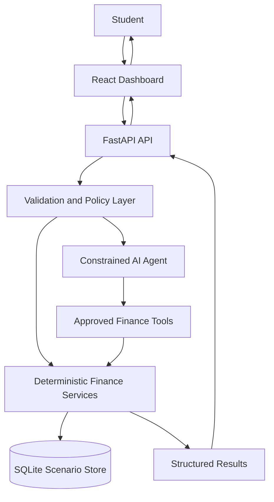

# FinBridge AI — Architecture

**Version:** 1.0  
**Architecture style:** Small modular frontend/backend application  
**MVP principle:** Deterministic finance tools first; AI explains and orchestrates approved tools.

## 1. Technology Stack

### Frontend
- React + Vite
- TypeScript
- Tailwind CSS
- Recharts for charts
- Fetch API or a small typed API client

### Backend
- Python 3.11+ (use the version supported by the deployment platform)
- FastAPI
- Pydantic for request/response validation
- Python `Decimal` for money calculations
- SQLite for the MVP
- Pytest for backend tests

### Optional external services
- An LLM API for assistant responses.
- A reputable exchange-rate API, only if time and terms permit.
- Vercel for frontend and Render or another suitable host for backend.

The app must still have a clearly labelled demo mode if optional services are unavailable.

## 2. High-Level Data Flow



## 3. Main Request Flow

1. The user enters financial assumptions in the frontend.
2. Frontend validates obvious form errors and sends a typed request.
3. FastAPI validates the request using Pydantic.
4. A deterministic service calculates totals, shortfall, conversion, or savings targets.
5. If the user asks a natural-language question, the agent selects an approved tool or requests missing data.
6. The backend validates the tool arguments and executes the same deterministic functions.
7. The response includes values, currency, assumptions, and data-source metadata.
8. The frontend renders the results and any explanatory AI text.
9. Demo scenarios and safe operation metadata may be stored in SQLite.

## 4. Recommended Repository Structure

```text
finbridge-ai/
├── README.md
├── PRD.md
├── architecture.md
├── rules.md
├── phases.md
├── design.md
├── memory.md
├── .gitignore
├── .env.example
├── frontend/
│   ├── package.json
│   ├── index.html
│   └── src/
│       ├── app/
│       ├── components/
│       ├── features/
│       │   ├── profile/
│       │   ├── budget/
│       │   ├── currency/
│       │   ├── planner/
│       │   └── assistant/
│       ├── lib/
│       ├── types/
│       └── main.tsx
├── backend/
│   ├── requirements.txt
│   ├── app/
│   │   ├── main.py
│   │   ├── api/
│   │   ├── schemas/
│   │   ├── services/
│   │   │   ├── budget.py
│   │   │   ├── currency.py
│   │   │   └── planner.py
│   │   ├── agent/
│   │   ├── db/
│   │   ├── core/
│   │   └── models/
│   └── tests/
├── docs/
│   ├── technical-documentation.md
│   ├── security-self-assessment.md
│   └── system-architecture.mmd
├── evidence/
│   ├── scenarios/
│   └── logs/
├── presentation/
└── demo/
```

Keep the six planning files at the repository root. Create folders only when there is real code or content to put in them.

## 5. API Contract (proposed)

### `GET /health`
Returns service status and application version.

### `POST /api/budget/analyze`
Example request:
```json
{
  "currency": "EUR",
  "tuition": "9000.00",
  "living_costs": "7000.00",
  "other_costs": "800.00",
  "available_savings": "5000.00",
  "months_remaining": 10
}
```
Example response:
```json
{
  "currency": "EUR",
  "total_estimated_cost": "16800.00",
  "funding_gap": "11800.00",
  "surplus": "0.00",
  "required_monthly_savings": "1180.00",
  "assumptions": ["Amounts are user-provided estimates."]
}
```
Use decimal strings for money at API boundaries to avoid floating-point ambiguity.

### `POST /api/currency/convert`
Request fields: `amount`, `from_currency`, `to_currency`, `rate`, `rate_source`, `rate_timestamp`, `is_illustrative`.

### `POST /api/planner/tuition`
Request fields: `target_amount`, `available_savings`, `months_remaining`, `currency`, optional `payment_date`.

### `POST /api/agent/chat`
Request fields: `message`, optional structured `profile` or `scenario_id`.
Response fields: `answer`, optional `tool_results`, `assumptions`, `mode` (`llm` or `demo`).

### `GET /api/scenarios/{id}`
Returns a saved non-sensitive scenario, if persistence is implemented.

These contracts are proposals; update both frontend and backend together if they change.

## 6. Data Model

Minimal `Scenario` fields:
- `id`
- `created_at`
- `base_currency`
- `target_currency`
- `tuition_amount`
- `living_costs`
- `other_costs`
- `available_savings`
- `months_remaining`
- `rate_value` (optional)
- `rate_source` (optional)
- `rate_timestamp` (optional)
- `is_illustrative_rate`
- `calculation_result_json` or equivalent structured fields

Do not store full chat history by default. If saving user scenarios, make the behaviour clear and store only necessary data.

## 7. Agent Boundary

The LLM may interpret intent, ask clarifying questions, select from an allowlist of tools, and explain returned results. It must not:
- Perform authoritative financial arithmetic itself.
- Invent exchange rates, fees, or provider policies.
- execute transfers or external side effects.
- bypass input validation or permissions.
- claim that a simulated operation is real.

Use a bounded tool loop and validate all tool inputs/outputs.

## 8. Error Handling

Use consistent error responses:
```json
{
  "error": {
    "code": "VALIDATION_ERROR",
    "message": "Please provide a valid amount and currency."
  }
}
```

Recommended codes: `VALIDATION_ERROR`, `MISSING_INPUT`, `RATE_UNAVAILABLE`, `NOT_FOUND`, `AI_UNAVAILABLE`, `INTERNAL_ERROR`.

Avoid returning stack traces or secrets to clients.

## 9. Deployment and Environment

Frontend environment:
- `VITE_API_BASE_URL`

Backend environment:
- `APP_ENV`
- `DATABASE_URL` (optional if using a default SQLite path)
- `LLM_API_KEY` (optional)
- `LLM_MODEL` (if required by provider)
- `CURRENCY_API_KEY` (only if a provider needs it)

Never put private keys in `VITE_*` variables; frontend environment values are public in the built app.

## 10. Observability and Evidence

- Add request IDs if feasible.
- Log operation type, result status, and scenario identifier—not secrets or unnecessary personal data.
- Keep reproducible example inputs and expected outputs.
- Capture screenshots and short logs for the competition evidence package.
